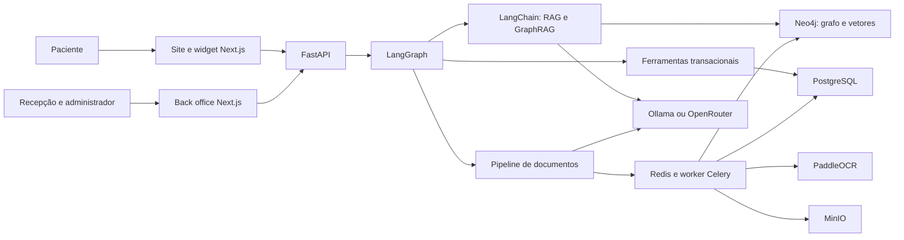

# Alyvo — Plano técnico do projeto

## 1. Resumo

**Alyvo** será o codinome de um assistente multimodal para clínicas, criado como projeto de portfólio. O sistema demonstrará, em um caso de uso coerente, domínio de:

- IA generativa e modelos locais.
- LangChain e LangGraph.
- RAG vetorial e GraphRAG com Neo4j.
- OCR com PaddleOCR.
- Agentes com ferramentas transacionais.
- Processamento assíncrono de documentos.
- Chat multimodal para pacientes.
- Back office para recepção e administração.
- Avaliação automatizada de OCR, recuperação, respostas e fluxos.

O MVP usará somente dados sintéticos. Alyvo é um codinome, sem pretensão de registro ou lançamento comercial. Caso evolua para produto, será renomeado.

### Critérios gerais de sucesso

- Responder dúvidas sobre clínica, médicos, convênios, especialidades, exames e unidades, sempre citando as fontes.
- Agendar e cancelar consultas sem permitir conflitos de horário.
- Identificar pacientes com CPF e código temporário.
- Receber documentos no chat, executar OCR e pedir confirmação antes de salvar.
- Permitir que administradores cadastrem conhecimento, médicos e relacionamentos.
- Refletir alterações aprovadas no GraphRAG.
- Rodar integralmente em ambiente local.
- Permitir trocar o modelo local por OpenRouter sem modificar os fluxos de negócio.
- Impedir acesso cruzado entre clínicas.

## 2. Escopo do produto

### Interface do paciente

O paciente acessará um site demonstrativo de uma clínica e abrirá o widget do Alyvo.

Sem autenticação, poderá:

- Consultar especialidades, unidades e serviços.
- Perguntar quais médicos atendem determinada especialidade.
- Verificar quais convênios são aceitos.
- Consultar preparos e orientações administrativas aprovadas.
- Receber respostas com fontes consultadas.

Após autenticação, poderá:

- Consultar horários disponíveis.
- Agendar uma consulta.
- Consultar ou cancelar seus agendamentos.
- Fazer cadastro pelo chat.
- Enviar identidade, carteirinha do convênio e pedido médico.
- Conferir e corrigir os campos extraídos antes de salvá-los.
- Pedir atendimento humano, gerando um ticket para a recepção.

O chat não realizará diagnóstico, prescrição, triagem clínica ou orientação de emergência.

### Back office

Haverá dois perfis:

- **Administrador:** configura a clínica, usuários, médicos, especialidades, convênios, unidades, documentos e conhecimento.
- **Recepção:** acompanha agenda, pacientes, documentos, conversas pendentes e tickets.

Módulos previstos:

- Dashboard operacional.
- Agenda por médico, data e unidade.
- Pacientes e documentos enviados.
- Tickets originados pelo chat.
- Médicos, especialidades, convênios, unidades e exames.
- Upload e processamento de documentos institucionais.
- Fila de revisão da ingestão.
- Explorador somente leitura do grafo.
- Histórico de ingestões, alterações e auditoria.

### Fora do MVP

- Prontuário eletrônico.
- Diagnóstico ou aconselhamento médico.
- Pagamentos.
- Telemedicina.
- Integração com Google Calendar ou sistemas hospitalares.
- Dados reais de pacientes.
- Aplicativo móvel nativo.
- Transferência de conversa em tempo real para um atendente.

## 3. Arquitetura

### Stack definida

- **Frontend:** Next.js, TypeScript, React e componentes acessíveis.
- **Backend:** Python com FastAPI.
- **Orquestração de IA:** LangGraph para estados e decisões; LangChain dentro dos nós de recuperação, prompts e ferramentas.
- **Banco operacional:** PostgreSQL.
- **Grafo e vetores:** Neo4j.
- **Fila e cache:** Redis.
- **Processamento assíncrono:** Celery.
- **Arquivos:** MinIO.
- **OCR:** PaddleOCR.
- **LLM local:** Ollama com `qwen3:8b` como padrão inicial.
- **Embeddings locais:** BGE-M3.
- **LLM externo opcional:** OpenRouter.
- **E-mail local e códigos temporários:** Mailpit.
- **Infraestrutura local:** Docker Compose.
- **Testes de interface:** Playwright.
- **Testes Python:** Pytest.
- **Avaliação de RAG:** Ragas com conjunto de perguntas esperado.
- **Contratos frontend/backend:** OpenAPI gerado pelo FastAPI e cliente TypeScript gerado automaticamente.

### Organização do repositório

- `apps/web`: widget, site demonstrativo e back office.
- `apps/api`: API FastAPI, domínio, autenticação e LangGraph.
- `apps/worker`: OCR, ingestão e projeção assíncrona.
- `packages/contracts`: cliente TypeScript gerado pelo OpenAPI.
- `infra`: Docker Compose, configurações e observabilidade.
- `datasets`: dados sintéticos, documentos e conjunto de avaliação.
- `tests`: testes integrados e cenários ponta a ponta.

## 4. Responsabilidades dos componentes de IA

### LangGraph

Será responsável por manter o estado da conversa e escolher o próximo fluxo:

1. Classificar a intenção.
2. Verificar se a ação exige autenticação.
3. Encaminhar para RAG vetorial, GraphRAG, agenda, cancelamento, OCR ou ticket.
4. Solicitar informações ausentes.
5. Exigir confirmação antes de ações com efeito.
6. Executar a ferramenta correspondente.
7. Compor a resposta final.
8. Encerrar ou retornar à conversa.

O estado conterá:

- Clínica atual.
- Sessão e usuário autenticado.
- Intenção.
- Entidades detectadas.
- Dados ainda necessários.
- Documentos anexados.
- Recuperações e fontes.
- Ação pendente de confirmação.
- Resultado de ferramentas.
- Histórico resumido da conversa.

### LangChain

Será usado dentro dos nós para:

- Construção de prompts.
- Extração estruturada de entidades.
- Recuperação vetorial.
- Recuperação híbrida.
- Composição do contexto.
- Invocação padronizada dos modelos.
- Geração de respostas com fontes.
- Estruturação de dados extraídos por OCR.

### Provedores abstratos

O domínio não chamará Ollama, OpenRouter ou PaddleOCR diretamente. Serão criadas interfaces para:

- `ChatModelProvider`
- `EmbeddingProvider`
- `OcrProvider`
- `ObjectStorageProvider`
- `NotificationProvider`

A configuração selecionará o provedor:

- `LLM_PROVIDER=ollama` no ambiente padrão.
- `LLM_PROVIDER=openrouter` quando houver chave configurada.
- Os embeddings continuarão locais por padrão.
- A troca de provedor não poderá alterar LangGraph, regras de agenda ou contratos da API.

## 5. RAG e GraphRAG

### Conteúdo vetorial

Documentos aprovados serão:

1. Armazenados originalmente no MinIO.
2. Convertidos em texto.
3. Divididos em trechos.
4. Vetorizados com BGE-M3.
5. Gravados como nós `Chunk` no Neo4j.
6. Ligados ao documento e às entidades mencionadas.
7. Indexados com `tenant_id`, origem, versão e status.

O LLM nunca receberá embeddings. Receberá a pergunta e os trechos de texto recuperados.

### Modelo de grafo

Principais nós:

- `Clinic`
- `Unit`
- `Doctor`
- `Specialty`
- `Insurer`
- `Exam`
- `Service`
- `Document`
- `Chunk`

Principais relacionamentos:

- `WORKS_AT`
- `HAS_SPECIALTY`
- `ACCEPTS`
- `PERFORMS`
- `OFFERS`
- `BELONGS_TO`
- `HAS_DOCUMENT`
- `HAS_CHUNK`
- `MENTIONS`
- `SUPPORTED_BY`

Disponibilidade e agendamentos não ficarão no Neo4j. O PostgreSQL será a única fonte de verdade para dados transacionais.

### Estratégias de recuperação

- **RAG vetorial:** perguntas sobre normas, preparo, documentos e conteúdo textual.
- **Consulta ao grafo:** perguntas relacionais, como médico + especialidade + convênio + unidade.
- **GraphRAG híbrido:** busca vetorial encontra documentos ou entidades iniciais; o grafo expande as relações; os resultados são classificados e entregues ao LLM.
- **Busca estruturada:** horários e agendamentos serão consultados exclusivamente no PostgreSQL.

Toda resposta baseada em conhecimento deverá retornar:

- Resposta.
- Fontes.
- Trechos utilizados.
- Grau interno de confiança.
- Indicação clara quando não houver evidência suficiente.

Baixa confiança ou ausência de fontes deverá gerar uma resposta limitada e oferecer a criação de um ticket.

## 6. Ingestão administrativa

### Dados estruturados

Médicos, especialidades, convênios, unidades, exames e serviços serão cadastrados por formulários.

O PostgreSQL armazenará a versão oficial. Uma tabela de eventos transacionais registrará alterações. O worker projetará essas alterações no Neo4j de maneira idempotente.

Exemplo ao adicionar um médico:

1. Administrador preenche o formulário.
2. API valida e salva no PostgreSQL.
3. Evento de projeção é criado na mesma transação.
4. Worker cria ou atualiza o médico no Neo4j.
5. Relacionamentos aprovados são atualizados.
6. O back office mostra o estado da sincronização.

### Documentos institucionais

O fluxo será:

1. Upload.
2. Validação do arquivo.
3. Armazenamento no MinIO.
4. OCR quando necessário.
5. Extração de texto e entidades.
6. Geração de uma prévia.
7. Revisão administrativa.
8. Aprovação ou rejeição.
9. Vetorização e atualização do grafo.
10. Disponibilização para o chat.

Nenhum documento alterará o conhecimento publicado automaticamente.

Estados da ingestão:

- `uploaded`
- `processing`
- `review_required`
- `approved`
- `published`
- `rejected`
- `failed`

## 7. OCR e documentos do paciente

### Tipos iniciais

- Documento de identidade.
- Carteirinha de convênio.
- Pedido médico.

### Fluxo

1. Paciente envia imagem ou PDF pelo chat.
2. Arquivo é armazenado de forma privada.
3. Worker executa PaddleOCR.
4. LLM converte o texto em campos estruturados.
5. O chat apresenta os campos ao paciente.
6. Paciente confirma ou corrige.
7. Somente após confirmação os dados são persistidos.
8. Documento fica disponível para a recepção.

Documentos de pacientes nunca serão incluídos no GraphRAG institucional.

Cada documento terá:

- Clínica.
- Paciente.
- Tipo.
- Arquivo original.
- Resultado bruto do OCR.
- Campos estruturados.
- Confiança por campo.
- Estado de confirmação.
- Data e usuário responsável por alterações.

## 8. Identidade, agenda e ações transacionais

### Autenticação do paciente

- Dúvidas públicas não exigem autenticação.
- Agendar, cancelar, consultar dados ou enviar documentos exige autenticação.
- O paciente informa CPF.
- O sistema envia um código temporário por e-mail no ambiente demonstrativo.
- Mailpit captura os e-mails localmente.
- O código terá expiração, limite de tentativas e uso único.
- Paciente inexistente poderá iniciar cadastro pelo chat.
- Dados extraídos de documento só serão usados após confirmação.

O CPF será normalizado, criptografado para armazenamento e acompanhado por um HMAC para busca por igualdade. O CPF completo não aparecerá em logs.

### Agenda

O PostgreSQL armazenará:

- Regras de disponibilidade.
- Bloqueios.
- Duração por serviço.
- Fuso horário da clínica.
- Consultas.
- Cancelamentos.
- Histórico de estado.

Fluxo de agendamento:

1. Identificar especialidade, médico ou unidade.
2. Consultar disponibilidade real.
3. Apresentar opções ao paciente.
4. Receber escolha.
5. Exibir resumo.
6. Solicitar confirmação.
7. Criar o agendamento em transação.
8. Confirmar ao paciente.

Uma restrição de intervalo no PostgreSQL impedirá sobreposição de consultas confirmadas para o mesmo médico, inclusive sob concorrência.

Fluxo de cancelamento:

1. Autenticar paciente.
2. Listar apenas os agendamentos daquele paciente e clínica.
3. Selecionar agendamento.
4. Solicitar confirmação.
5. Aplicar a política administrativa configurada.
6. Registrar cancelamento e auditoria.

## 9. APIs e contratos públicos

Prefixo: `/api/v1`.

### Chat

- `POST /chat/sessions`
- `POST /chat/sessions/{id}/messages`
- `GET /chat/sessions/{id}/events` via SSE
- `POST /chat/sessions/{id}/attachments`

Eventos do chat:

- `token`
- `status`
- `citation`
- `form_request`
- `confirmation_request`
- `tool_result`
- `ticket_created`
- `completed`
- `error`

### Autenticação

- `POST /auth/patient/start`
- `POST /auth/patient/verify`
- `POST /auth/patient/register`
- `POST /auth/staff/login`
- `POST /auth/refresh`
- `POST /auth/logout`

### Agenda

- `GET /availability`
- `POST /appointments`
- `GET /appointments/me`
- `POST /appointments/{id}/cancel`

### Documentos

- `POST /patient/documents`
- `GET /patient/documents`
- `GET /patient/documents/{id}`
- `POST /patient/documents/{id}/confirm`

### Back office

- CRUD de médicos, especialidades, convênios, unidades, exames e serviços.
- Consulta de pacientes e agendamentos.
- Consulta e tratamento de tickets.
- Upload e acompanhamento de ingestões.
- Aprovação e rejeição de prévias.
- Consulta somente leitura ao grafo.
- Consulta de auditoria.

Todos os DTOs serão definidos no FastAPI e consumidos pelo frontend por um cliente gerado, evitando contratos duplicados manualmente.

## 10. Frontend

### Widget do paciente

- Pode ser incorporado ao site demonstrativo por script.
- Tela responsiva.
- Histórico da conversa.
- Upload por botão e arrastar arquivo.
- Cartões de médicos, horários e agendamentos.
- Fontes expansíveis.
- Formulários gerados dentro da conversa.
- Confirmação explícita antes de qualquer ação.
- Estados visuais de processamento, erro e atendimento humano.
- Acessibilidade por teclado e leitores de tela.

### Back office

Páginas:

- Login.
- Dashboard.
- Agenda.
- Agendamentos.
- Pacientes.
- Documentos de pacientes.
- Tickets.
- Médicos e especialidades.
- Convênios, unidades, exames e serviços.
- Base de conhecimento.
- Revisão de ingestões.
- Explorador do grafo.
- Auditoria e configurações.

O explorador do Neo4j será somente leitura, com filtros por entidade e clínica. Não aceitará Cypher arbitrário vindo do navegador.

## 11. Dados sintéticos

O projeto incluirá:

- Uma clínica principal para demonstração.
- Uma segunda clínica usada nos testes de isolamento.
- Unidades, médicos, especialidades, convênios, exames e serviços fictícios.
- Grades de horários.
- Pacientes sintéticos.
- Documentos institucionais em PDF.
- Identidades, carteirinhas e pedidos médicos sintéticos.
- Imagens limpas, rotacionadas, desfocadas e com ruído para validar OCR.
- Perguntas e respostas esperadas para RAG e GraphRAG.

Nenhum artefato poderá conter dados pessoais reais.

## 12. Segurança e privacidade

- `tenant_id` obrigatório em dados operacionais e no grafo.
- PostgreSQL com Row-Level Security como defesa adicional.
- Filtros obrigatórios de clínica nas consultas ao Neo4j.
- Prefixos privados por clínica e paciente no MinIO.
- URLs temporárias para acesso a documentos.
- RBAC para administrador, recepção e paciente.
- Auditoria de visualizações e alterações sensíveis.
- Segredos somente em variáveis de ambiente.
- Validação de tipo, tamanho e conteúdo dos uploads.
- Limite de requisições para login, OTP e chat.
- Proteção contra prompt injection em documentos.
- O texto recuperado será tratado como dado, nunca como instrução.
- Respostas administrativas não poderão ultrapassar as evidências recuperadas.
- Logs não armazenarão CPF, documentos completos ou conteúdo sensível.
- Exclusão lógica e política de retenção configurável.
- Nenhuma chamada a provedor externo será feita quando o ambiente estiver em modo local.

## 13. Observabilidade e autovalidação

Cada requisição terá um identificador de correlação passando por API, LangGraph, worker e ferramentas.

Serão registrados:

- Intenção escolhida.
- Nós percorridos no LangGraph.
- Tempo de recuperação.
- Fontes utilizadas.
- Modelo e provedor.
- Quantidade de tokens quando disponível.
- Tempo de OCR.
- Erros de ferramentas.
- Resultado de ações transacionais.
- Dados sensíveis mascarados.

Um comando único, `make validate`, deverá:

1. Subir ou verificar os serviços.
2. Aplicar migrações.
3. Carregar dados sintéticos.
4. Verificar saúde da infraestrutura.
5. Executar testes unitários.
6. Executar testes de integração.
7. Executar testes ponta a ponta.
8. Executar avaliações de OCR, RAG e GraphRAG.
9. Gerar um relatório local com resultados e falhas.

## 14. Fases de implementação

### Fase 1 — Fundação

- Criar monorepo e Docker Compose.
- Configurar Next.js, FastAPI, worker e contratos.
- Subir PostgreSQL, Neo4j, Redis, MinIO, Ollama e Mailpit.
- Criar health checks, migrações e dados sintéticos básicos.

**Saída:** ambiente local iniciado por um único comando.

### Fase 2 — Domínio operacional

- Implementar multi-tenancy, autenticação e RBAC.
- Criar médicos, especialidades, convênios, unidades e agenda.
- Implementar disponibilidade, agendamento e cancelamento.
- Criar outbox e projeção PostgreSQL → Neo4j.

**Saída:** agenda funcional sem IA e sem conflitos.

### Fase 3 — Conhecimento e GraphRAG

- Implementar upload institucional.
- Extrair texto, dividir documentos e gerar embeddings.
- Modelar grafo e índices vetoriais.
- Implementar RAG vetorial, busca no grafo e recuperação híbrida.
- Adicionar fontes e controle de baixa confiança.

**Saída:** perguntas administrativas respondidas com evidências.

### Fase 4 — LangGraph e chat

- Implementar estado conversacional.
- Criar roteador de intenções.
- Integrar RAG, GraphRAG e ferramentas de agenda.
- Implementar confirmações e criação de tickets.
- Adicionar streaming por SSE.

**Saída:** fluxo completo de dúvidas, agendamento e cancelamento pelo chat.

### Fase 5 — OCR e documentos

- Implementar uploads privados.
- Integrar PaddleOCR.
- Estruturar identidade, carteirinha e pedido.
- Criar revisão e confirmação pelo paciente.
- Disponibilizar documentos no back office.

**Saída:** fluxo multimodal completo e auditável.

### Fase 6 — Interfaces

- Finalizar site demonstrativo e widget.
- Criar cartões, formulários e anexos no chat.
- Implementar todos os módulos do back office.
- Criar explorador do grafo e telas de ingestão.

**Saída:** experiência demonstrável de ponta a ponta.

### Fase 7 — Qualidade e apresentação

- Completar testes e conjunto de avaliações.
- Medir desempenho e qualidade.
- Revisar isolamento e segurança.
- Criar documentação, diagrama e roteiro de demonstração.
- Gerar relatório final de autovalidação.

**Saída:** projeto de portfólio reproduzível e tecnicamente justificável.

## 15. Testes e critérios de aceitação

### Testes funcionais

- Pergunta pública retorna resposta com fonte.
- Pergunta relacional combina médico, especialidade, convênio e unidade.
- Horários vêm do PostgreSQL, não do LLM.
- Agendamento exige autenticação e confirmação.
- Duas requisições concorrentes não reservam o mesmo horário.
- Paciente só visualiza e cancela seus próprios agendamentos.
- OCR não salva campos antes da confirmação.
- Documento de paciente não aparece no conhecimento compartilhado.
- Novo médico aprovado passa a ser encontrado no chat.
- Ingestão rejeitada não altera o GraphRAG.
- Baixa confiança oferece ticket em vez de inventar resposta.
- Troca de Ollama por OpenRouter não altera os contratos.
- Uma clínica nunca recupera registros ou documentos da outra.

### Metas de avaliação

- Acurácia de roteamento de intenção: pelo menos 95%.
- Recall@5 da recuperação: pelo menos 85%.
- Respostas fundamentadas nas fontes: pelo menos 90%.
- Precisão das citações: pelo menos 90%.
- Campos obrigatórios do OCR em documentos sintéticos limpos: pelo menos 90%.
- Campos obrigatórios em imagens degradadas: pelo menos 80%.
- Zero sobreposição de consultas em testes concorrentes.
- Zero vazamento entre clínicas nos testes automatizados.
- Fluxos críticos ponta a ponta aprovados no Playwright.

### Cenário principal de demonstração

1. Visitante pergunta quais cardiologistas atendem determinado convênio.
2. GraphRAG combina médico, especialidade, convênio e unidade.
3. Resposta apresenta as fontes.
4. Visitante escolhe agendar.
5. Chat solicita autenticação.
6. Paciente recebe e confirma o código.
7. Agenda oferece horários reais.
8. Paciente confirma a consulta.
9. Paciente envia carteirinha e pedido médico.
10. OCR extrai os campos.
11. Paciente corrige e confirma.
12. Recepção visualiza agendamento e documentos.
13. Administrador adiciona novo médico e publica a alteração.
14. Uma nova pergunta já encontra o médico atualizado.
15. Uma pergunta não coberta gera ticket para a recepção.

## 16. Premissas finais

- **Alyvo** é somente um codinome de portfólio.
- O projeto é local-first e usa apenas dados sintéticos.
- O MVP demonstra uma clínica, mas a arquitetura nasce multi-tenant.
- PostgreSQL é a fonte de verdade operacional.
- Neo4j concentra conhecimento, relações e vetores.
- LangGraph controla o fluxo; LangChain executa as capacidades internas.
- PaddleOCR é o OCR padrão.
- Ollama é o provedor padrão de LLM; OpenRouter é opcional.
- O chat é administrativo e informativo, sem funções clínicas.
- Toda ação transacional ou persistência de dados extraídos exige confirmação explícita.
- Conhecimento novo só é publicado após aprovação administrativa.

## 17. Design System e referências visuais

**Editorial Premium** é o design system oficial do MVP. Sua direção é editorial suíça, minimalista, clínica, tecnológica e acessível, com grande uso de espaço negativo, alta legibilidade e uma tarefa principal por tela.

- **Paleta:** Paper `#F7F7F2` como fundo principal; Ink `#101828` para texto, títulos e ícones; Cobalt `#2457FF` para ações primárias, seleção, links e foco; Lime `#B8F34A` somente em pequenos indicadores de disponibilidade, sucesso ou validação; Cool Gray `#D8DDE6` para divisórias, bordas e estados neutros; Success `#16A34A`, Warning `#D97706` e Error `#DC2626` para estados semânticos. Lime nunca substituirá Cobalt como cor interativa nem será usado em grandes fundos.
- **Tipografia:** Inter, com Display `64/64 800`, H1 `48/52 700`, H2 `32/38 600`, Body `16/24 400` e Label `12/16 500` com tracking.
- **Espaçamento e forma:** escala de `4`, `8`, `12`, `16`, `24`, `32`, `48` e `64px`; raios de `4`, `8` e `12px`; bordas de `1px` em Cool Gray; sombras discretas somente quando a hierarquia exigir.
- **Iconografia:** Lucide, traço consistente, tamanhos de `20px` e `24px`, sem emojis.
- **Regras anti-poluição visual:** uma mensagem principal por seção, até dois CTAs simultâneos, no máximo três benefícios no hero, chat fechado por padrão, conteúdo progressivo abaixo da dobra e ausência de cards, métricas ou arredondamentos excessivos.
- **Acessibilidade:** contraste WCAG AA, foco visível, alvos mínimos de `44px`, navegação por teclado, suporte a reduced motion e texto base mínimo de `16px`.

O diretório `docs/design-system/` é a fonte de documentação e referências do sistema. Consulte o [README do Design System](docs/design-system/README.md) para as regras completas e o índice dos previews.

Toda nova tela deverá consultar o README e os previews relevantes antes da implementação. Os previews são referências direcionais, não contratos pixel-perfect; os tokens e componentes implementados no código serão a fonte executável de verdade.
