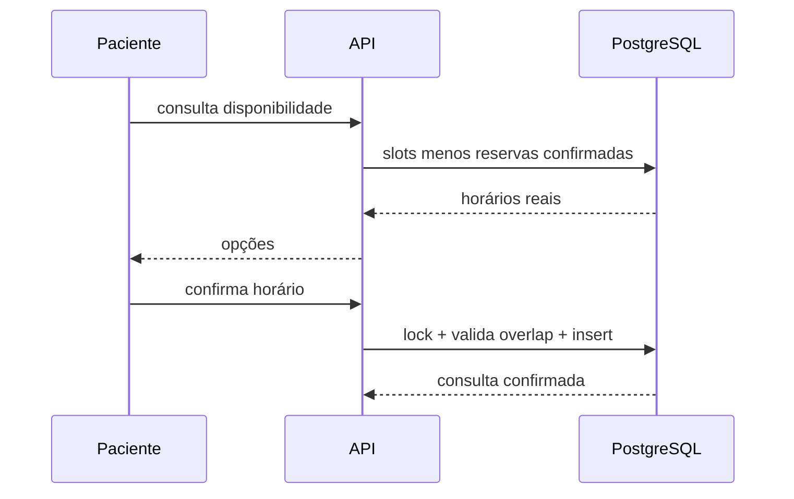

# Arquitetura do Alyvo

## Fronteiras e fontes de verdade

- **PostgreSQL:** única fonte operacional. A API nunca consulta o LLM para
  disponibilidade, agendamento ou cancelamento.
- **Neo4j:** projeção de clínica, profissionais, catálogos, documentos e chunks
  em índice vetorial de 1.024 dimensões. A recuperação híbrida parte de seeds
  vetoriais, expande relações e reranqueia resultados; toda consulta filtra o tenant.
- **Redis/Celery:** OCR, embeddings e projeção de outbox fora da requisição.
- **MinIO:** objetos privados prefixados por clínica e paciente.
- **LangGraph:** estado e roteamento da conversa. Os nós chamam recuperação ou
  ferramentas transacionais; as implementações de modelo ficam atrás de adapters.

## Fluxo de agendamento

Em PostgreSQL, uma exclusion constraint GiST bloqueia intervalos sobrepostos
para o mesmo médico e tenant. O serviço também faz uma verificação explícita
para produzir erro `409` compreensível.

## Fluxo de conhecimento

1. O administrador cria uma ingestão em `review_required`.
2. Texto e entidades são revisados; nada é publicado automaticamente.
3. A aprovação muda o documento para `published` e grava um evento na outbox na
   mesma transação.
4. O worker aplica `MERGE` ou deleção idempotente e tenant-scoped no Neo4j.
5. O índice vetorial recupera seeds; o grafo expande evidências relacionadas e
   o reranking compõe as fontes. Baixa confiança oferece ticket.

## Fluxo de documento do paciente

O original fica privado no MinIO. OCR bruto, campos e confiança permanecem em
um rascunho temporário no Redis. Somente a confirmação explícita grava esses
valores no PostgreSQL e torna o documento visível à recepção. Esses documentos
nunca são projetados no grafo institucional.

## Segurança da demonstração

- CPF normalizado, protegido e acompanhado por HMAC para busca por igualdade;
- OTP expira, tem limite de tentativas e uso único;
- JWT-like assinado localmente sem dados sensíveis;
- autorização de paciente e equipe em cada rota;
- RLS adicional documentada na migration PostgreSQL;
- uploads validados por tipo/tamanho e chaves privadas;
- contexto recuperado é marcado como dado, nunca como instrução;
- respostas clínicas são recusadas no roteador antes da recuperação.

