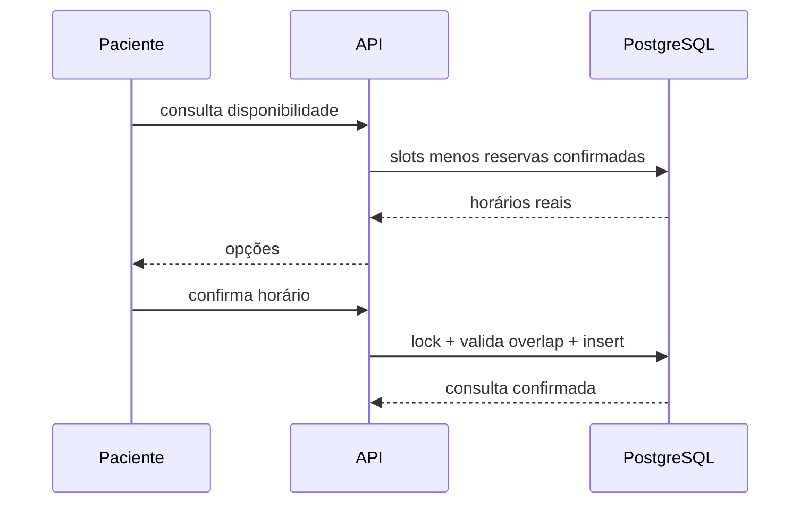

# Arquitetura do Alyvo

## Fronteiras e fontes de verdade

- **PostgreSQL:** única fonte operacional. A API nunca consulta o LLM para
  disponibilidade, agendamento ou cancelamento.
- **Neo4j:** projeção de clínica, profissionais, catálogos, documentos e chunks
  em índice vetorial de 1.024 dimensões. A recuperação híbrida combina top 30
  lexical e top 30 vetorial com RRF `k=60`; toda consulta filtra tenant e versão
  do índice. Expansão relacional e reranking só entram depois de superar seus
  gates de qualidade e latência.
- **Redis/Celery:** OCR, embeddings e projeção de outbox fora da requisição.
- **MinIO:** arquivos privados de conhecimento prefixados por clínica.
- **LangGraph:** grafo tipado dentro do FastAPI, com nós separados para
  normalização, classificação, roteamento, ferramentas e validação. Checkpoints
  ficam no schema PostgreSQL `langgraph`, usando `ChatSession.id` como thread.
- **LangChain:** interface comum de modelos e ferramentas. OpenRouter é o
  primário e Ollama local é o fallback para timeout, rate limit e falhas do
  provedor. O LLM nunca é fonte de verdade operacional.
- **LangSmith:** tracing e avaliação opcionais. O conteúdo é desidentificado e
  fluxos autenticados/sensíveis expõem somente metadados seguros.

## Fronteiras do código

```text
app/api             HTTP, schemas e tradução de erros
app/core            configuração, segurança, erros e observabilidade
app/domain          entidades e regras sem dependência de framework
app/agent           estado, roteamento composto e orquestração
app/tools           contratos Pydantic, registry e execução
app/retrieval       parsing, chunking, busca, answerability e citações
app/prompts         prompts versionados com nome, versão e hash
app/infrastructure  PostgreSQL, Neo4j, Redis, MinIO, LLM e embeddings
```

Routers chamam serviços de aplicação, providers são montados no composition
root e o worker reutiliza integrações sem importar routers. Testes de fronteira
impedem o domínio de importar FastAPI, LangChain ou clientes externos.

## Fluxo de agendamento



Em PostgreSQL, uma exclusion constraint GiST bloqueia intervalos sobrepostos
para o mesmo médico e tenant. O serviço também faz uma verificação explícita
para produzir erro `409` compreensível.

## Fluxo de conhecimento

1. O administrador cria uma ingestão em `review_required`.
2. Texto e entidades são revisados; nada é publicado automaticamente.
3. A aprovação muda o documento para `published` e grava um evento na outbox na
   mesma transação.
4. O worker aplica `MERGE` ou deleção idempotente e tenant-scoped no Neo4j.
5. A pergunta contextualizada passa por busca lexical e vetorial, RRF,
   reranking opcional, answerability e validação de citações.
6. Somente até cinco evidências rastreáveis chegam ao gerador. Evidência
   insuficiente ou conflitante produz abstinência explícita.

Chunks preservam título, seção, página, parent, hash de conteúdo, parser,
embedding e versão de índice. Mudanças de parsing, chunking ou embedding criam
uma nova versão paralela; o corte é feito por `KNOWLEDGE_INDEX_VERSION` depois
da validação.

## Roteamento e tools

Cada turno produz uma decisão estrita composta por domínio, ação, tópico,
risco, entidades, confiança e necessidade de esclarecimento. Segurança e
operações determinísticas têm precedência sobre a classificação do modelo. O
campo público `intent` da v1 é derivado dessa decisão para manter o contrato.

Tools têm argumentos e resultados Pydantic com campos extras proibidos. Cada
turno executa no máximo três tools e uma escrita. Escritas exigem autenticação,
autorização, confirmação e chave idempotente persistida em `tool_executions`.

## Segurança da demonstração

- CPF normalizado, protegido e acompanhado por HMAC para busca por igualdade;
- identificação contextual por CPF e data de nascimento, com rate limit;
- JWT-like assinado localmente sem dados sensíveis;
- autorização de paciente e equipe em cada rota;
- RLS adicional documentada na migration PostgreSQL;
- uploads validados por tipo/tamanho e chaves privadas;
- contexto recuperado é marcado como dado, nunca como instrução;
- respostas clínicas são recusadas no roteador antes da recuperação.
- catálogos operacionais possuem ferramentas distintas; uma consulta de
  convênio ou exame nunca é convertida implicitamente em busca de médicos;
- CPF, datas de nascimento, e-mail e tokens são removidos antes de tracing ou
  chamadas externas.

