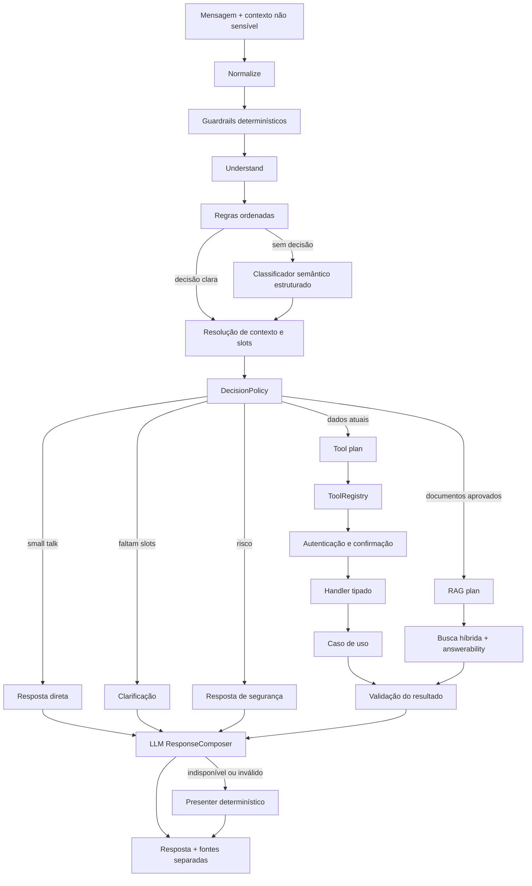

# Componentes do agente

O roteamento é híbrido. Segurança, saudações puras e operações críticas usam regras previsíveis. O classificador semântico é apenas o último recurso para linguagem ambígua e retorna um contrato validado; ele não executa ferramentas.

`DecisionPolicy` escolhe resposta direta, clarificação, tool ou RAG. Dados vivos de agenda e catálogo sempre vêm de tools. Políticas e informações institucionais vêm apenas de documentos publicados.

`ConversationContext` guarda somente preferências operacionais, como data e período. Identidade, tokens e dados pessoais não são persistidos nele. Uma saudação acompanhada de pedido funciona como marcador de tom e não interrompe a intenção principal.

O registry é a fonte de schema, risco, autenticação, confirmação, idempotência, timeout e auditoria das tools. Depois da execução, o `LlmResponseComposer` recebe o histórico recente, o rascunho seguro, o resultado estruturado e as evidências recuperadas. Ele pode alterar somente o texto apresentado; flags, fontes, autenticação, confirmação e resultados permanecem autoritativos.

Decisões clínicas e de segurança não dependem do LLM. Se o provedor falhar, exceder o limite ou produzir conteúdo com metadados internos, o presenter determinístico assume a resposta. Documentos recuperados são dados, nunca instruções.
