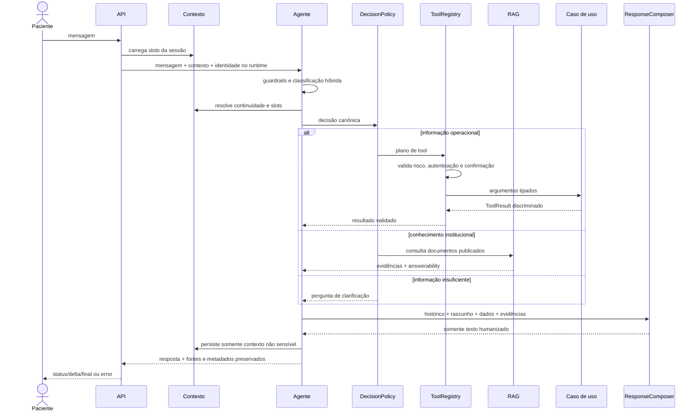

# Fluxo de chat

Saudações puras não acionam banco, embedding ou tools; podem usar apenas a composição de linguagem. Em mensagens compostas, como “Bom dia, quero horários para sexta”, a saudação é preservada no tom e o pedido operacional continua até o planejamento.

O modelo não escolhe livremente operações. A política decide a fonte de verdade e o registry controla a execução; o modelo redige a resposta final. Para RAG, somente evidências publicadas são fornecidas. Para agenda e catálogos, somente resultados das funções internas são fornecidos. As fontes são renderizadas separadamente pela interface.
