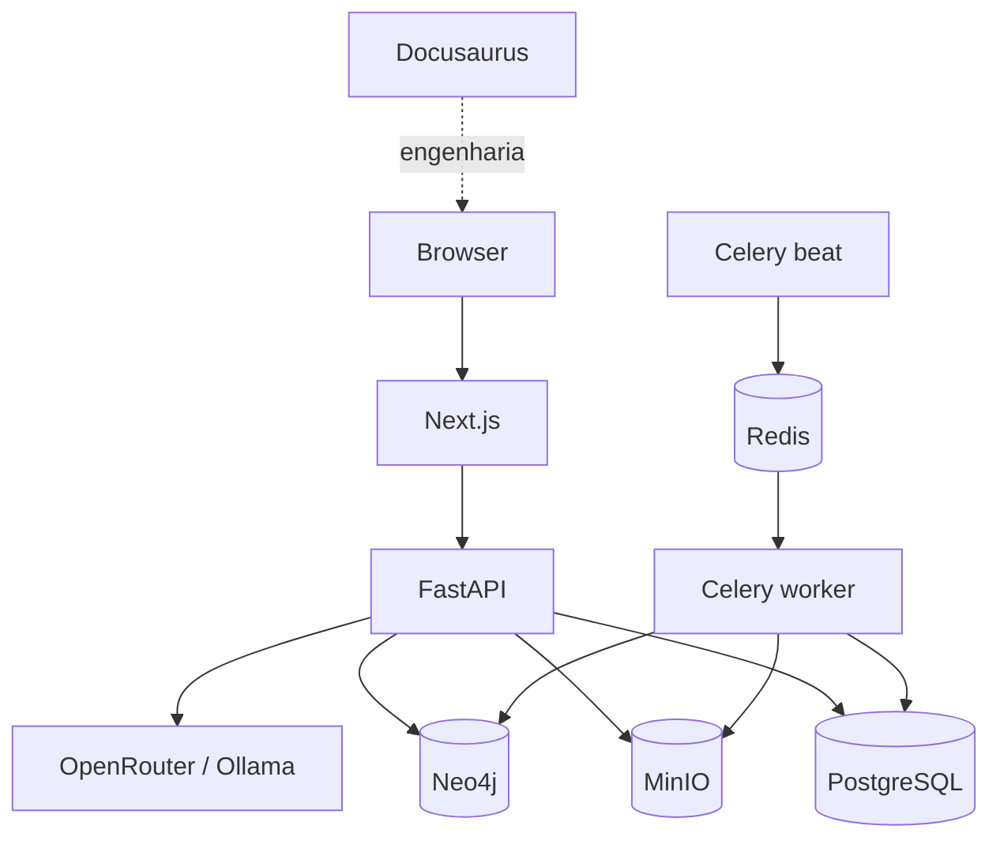

# Contêineres — C4

Consulte [Responsabilidades dos componentes](component-responsibilities.md) para entender por que cada serviço existe, quais dados mantém e como participa dos principais fluxos.
