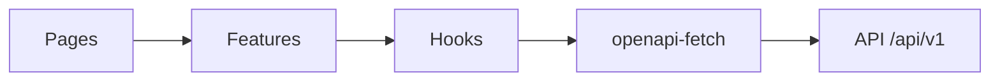

# Componentes do frontend

O Next.js é organizado por `features/auth`, `features/chat`, `features/scheduling` e `features/backoffice`. Fronteiras HTTP usam apenas o cliente `openapi-fetch` gerado. O chat usa reducer, renderizadores exaustivos da união `ToolResult` e componentes isolados de confirmação.

