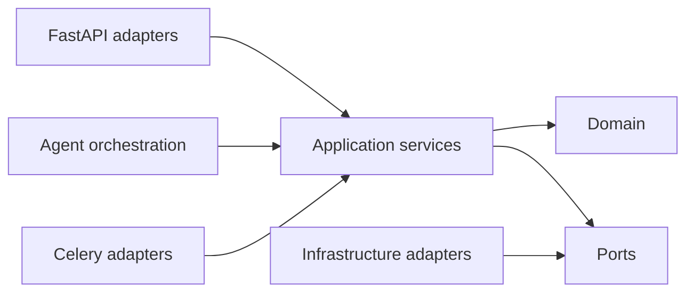

# Visão geral

O backend é um monólito modular com composition root em `app/bootstrap`, kernel em `app/shared`, módulos de negócio em `app/modules`, agente em `app/agent` e adapters HTTP em `app/api`.

Para uma descrição do papel de PostgreSQL, Redis, MinIO, Neo4j, Celery, Ollama e dos demais serviços, consulte [Responsabilidades dos componentes](component-responsibilities.md).

Dependências apontam para dentro: apresentação → aplicação → domínio. Domínio não conhece FastAPI, SQLAlchemy, LangGraph ou provedores. Escritas são delimitadas por Unit of Work e emitem auditoria/outbox atomicamente.

